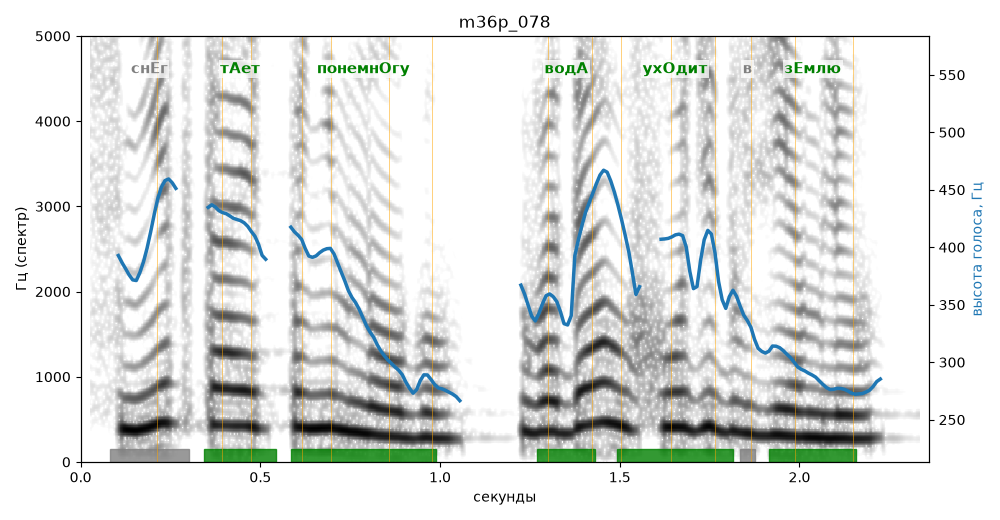

# m36p_078

Голос: **Пик (голос iPhone Milena), серия 36** · длительность 2.4 с
Эталон: Снег тает понемногу. Вода уходит в землю.
Распознано: Снекта это по-невного. Вода уходит в землю.
Расхождения в словах: «снег тает понемногу» → «снекта это по-невного»

## Ударения
(где нужно: ruaccent)

| слово | нужно | у голоса | |
|---|---|---|---|
| тает | тАет | тАет | ✓ |
| понемногу | понемнОгу | понемнОгу | ✓ |
| вода | водА | водА | ✓ |
| уходит | ухОдит | ухОдит | ✓ |
| землю | зЕмлю | зЕмлю | ✓ |

## Интонация
- ✓ «снег тает понемногу.» — конец фразы понижается — звучит законченно
- ✓ «вода уходит в землю.» — конец фразы понижается — звучит законченно
- Диапазон голоса 8.6 полутонов (живо), средняя высота 359 Гц

## Паузы и темп
- паузы на своих местах
- Темп 8.4 слога/с (быстро)

_Синяя линия — высота голоса. Над словами заглавная буква — где ударение должно быть; красным — голос поставил не туда (уверенно), оранжевым — возможно._
