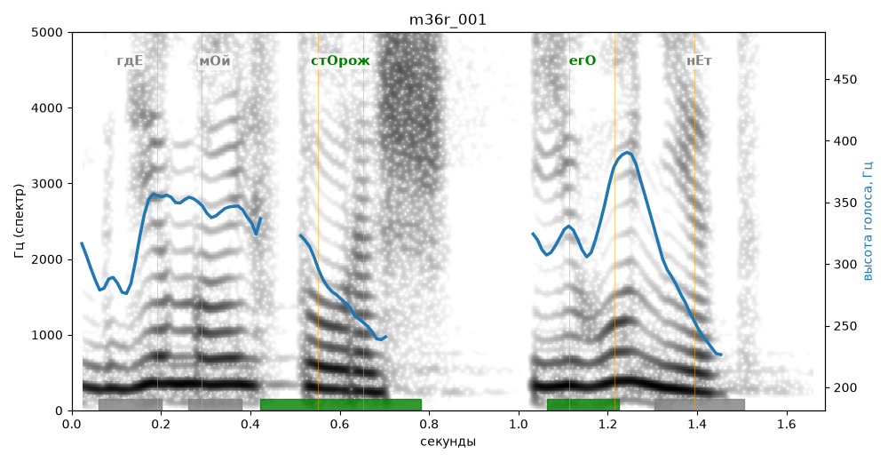

# m36r_001

Голос: **Рон (голос iPhone Milena), серия 36** · длительность 1.7 с
Эталон: Где мой сторож? Его нет!
Распознано: Где мой сторож? Его нет.
Слова: все совпали

## Ударения
(где нужно: ruaccent)

| слово | нужно | у голоса | |
|---|---|---|---|
| сторож | стОрож | стОрож | ✓ |
| его | егО | егО | ✓ |

## Интонация
- ✓ «где мой сторож?» — конец фразы понижается — звучит законченно
- ✓ «его нет!» — выделено слово «его» (+2.5 пт)
- Диапазон голоса 7.8 полутонов (живо), средняя высота 317 Гц

## Паузы и темп
- паузы на своих местах
- Темп 6.0 слога/с (нормально)

_Синяя линия — высота голоса. Над словами заглавная буква — где ударение должно быть; красным — голос поставил не туда (уверенно), оранжевым — возможно._
