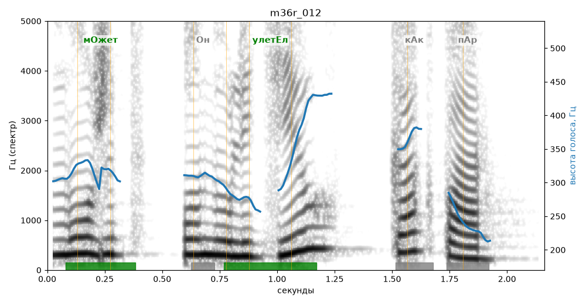

# m36r_012

Голос: **Рон (голос iPhone Milena), серия 36** · длительность 2.2 с
Эталон: Может, он улетел? Как пар?
Распознано: Может он улетел как пар?
Слова: все совпали

## Ударения
(где нужно: ruaccent)

| слово | нужно | у голоса | |
|---|---|---|---|
| может | мОжет | мОжет | ✓ |
| улетел | улетЕл | улетЕл | ✓ |

## Интонация
- ✓ «может он улетел?» — вопросительный подъём на слове «улетел»
- Диапазон голоса 11.0 полутонов (живо), средняя высота 309 Гц

## Паузы и темп
- паузы на своих местах
- Темп 6.4 слога/с (нормально)

_Синяя линия — высота голоса. Над словами заглавная буква — где ударение должно быть; красным — голос поставил не туда (уверенно), оранжевым — возможно._
