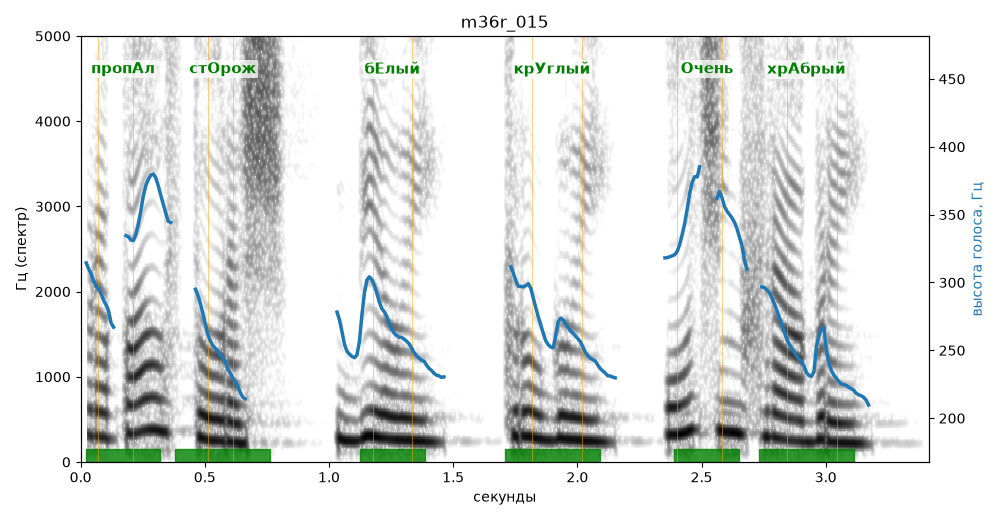

# m36r_015

Голос: **Рон (голос iPhone Milena), серия 36** · длительность 3.4 с
Эталон: Пропал сторож. Белый. Круглый. Очень храбрый
Распознано: пропал сторож, белый, круглый, очень храбрый.
Слова: все совпали

## Ударения
(где нужно: ruaccent)

| слово | нужно | у голоса | |
|---|---|---|---|
| пропал | пропАл | пропАл | ✓ |
| сторож | стОрож | стОрож | ✓ |
| белый | бЕлый | бЕлый | ✓ |
| круглый | крУглый | крУглый | ✓ |
| очень | Очень | Очень | ✓ |
| храбрый | хрАбрый | хрАбрый | ✓ |

## Интонация
- ✓ «пропал сторож.» — конец фразы понижается — звучит законченно
- ✓ «очень храбрый» — конец фразы понижается — звучит законченно
- Диапазон голоса 8.7 полутонов (живо), средняя высота 267 Гц

## Паузы и темп
- паузы на своих местах
- Темп 5.7 слога/с (нормально)

_Синяя линия — высота голоса. Над словами заглавная буква — где ударение должно быть; красным — голос поставил не туда (уверенно), оранжевым — возможно._
