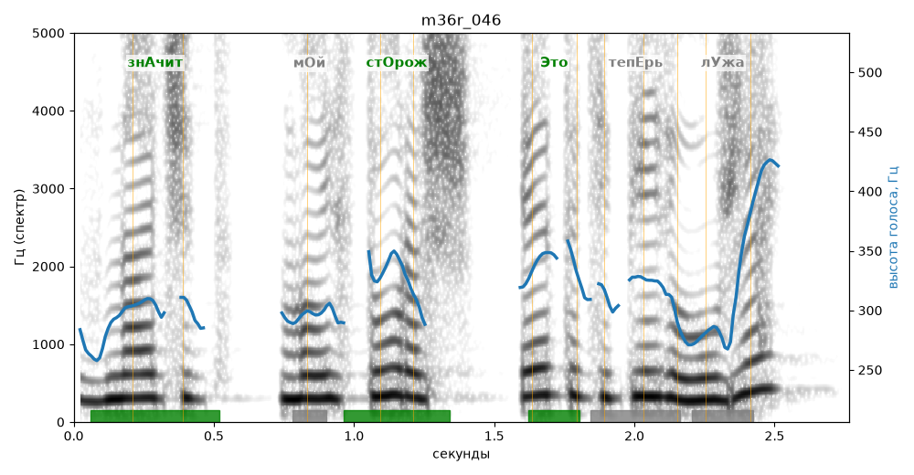

# m36r_046

Голос: **Рон (голос iPhone Milena), серия 36** · длительность 2.8 с
Эталон: Значит, мой сторож — это теперь лужа?
Распознано: Значит, мой сторож, это теперь уже?
Расхождения в словах: «лужа» → «уже»

## Ударения
(где нужно: ruaccent)

| слово | нужно | у голоса | |
|---|---|---|---|
| значит | знАчит | знАчит | ✓ |
| сторож | стОрож | стОрож | ✓ |
| это | Это | Это | ✓ |
| теперь | тепЕрь | — | ? |
| лужа | лУжа | лужА | ? не разобрать |

## Интонация
- ✗ «значит мой сторож это теперь лужа?» — нет вопросительного подъёма (самое высокое место — «это», в начале) — звучит как утверждение
- Диапазон голоса 6.7 полутонов (нормально), средняя высота 307 Гц

## Паузы и темп
- паузы на своих местах
- Темп 6.6 слога/с (быстро)

_Синяя линия — высота голоса. Над словами заглавная буква — где ударение должно быть; красным — голос поставил не туда (уверенно), оранжевым — возможно._
