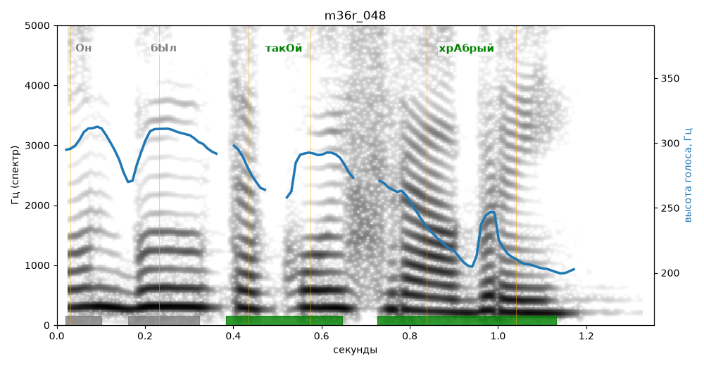

# m36r_048

Голос: **Рон (голос iPhone Milena), серия 36** · длительность 1.4 с
Эталон: Он был такой храбрый.
Распознано: Он был такой фраброй.
Расхождения в словах: «храбрый» → «фраброй»

## Ударения
(где нужно: ruaccent)

| слово | нужно | у голоса | |
|---|---|---|---|
| такой | такОй | такОй | ✓ |
| храбрый | хрАбрый | хрАбрый | ✓ |

## Интонация
- ✓ «он был такой храбрый.» — конец фразы понижается — звучит законченно
- Диапазон голоса 7.4 полутонов (живо), средняя высота 272 Гц

## Паузы и темп
- паузы на своих местах
- Темп 5.4 слога/с (нормально)

_Синяя линия — высота голоса. Над словами заглавная буква — где ударение должно быть; красным — голос поставил не туда (уверенно), оранжевым — возможно._
