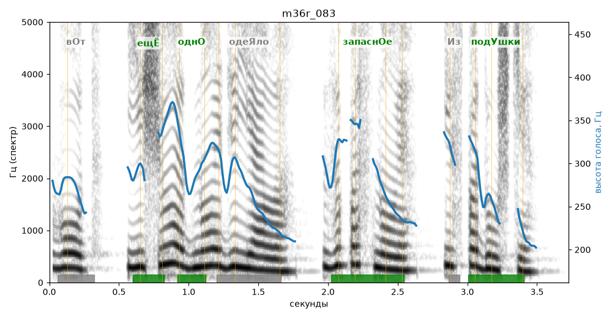

# m36r_083

Голос: **Рон (голос iPhone Milena), серия 36** · длительность 3.7 с
Эталон: Вот! Ещё одно одеяло. Запасное. Из подушки.
Распознано: Вот, еще одно идеало, запасное, из подушки.
Расхождения в словах: «одеяло» → «идеало»

## Ударения
(где нужно: ruaccent)

| слово | нужно | у голоса | |
|---|---|---|---|
| ещё | ещЁ | ещЁ | ✓ |
| одно | однО | однО | ✓ |
| одеяло | одеЯло | — | ? |
| запасное | запаснОе | запаснОе | ✓ |
| подушки | подУшки | подУшки | ✓ |

## Интонация
- ✓ «ещё одно одеяло.» — конец фразы понижается — звучит законченно
- ✓ «запасное.» — конец фразы понижается — звучит законченно
- ✓ «из подушки.» — конец фразы понижается — звучит законченно
- Диапазон голоса 8.5 полутонов (живо), средняя высота 279 Гц

## Паузы и темп
- паузы на своих местах
- Темп 6.7 слога/с (быстро)

_Синяя линия — высота голоса. Над словами заглавная буква — где ударение должно быть; красным — голос поставил не туда (уверенно), оранжевым — возможно._
