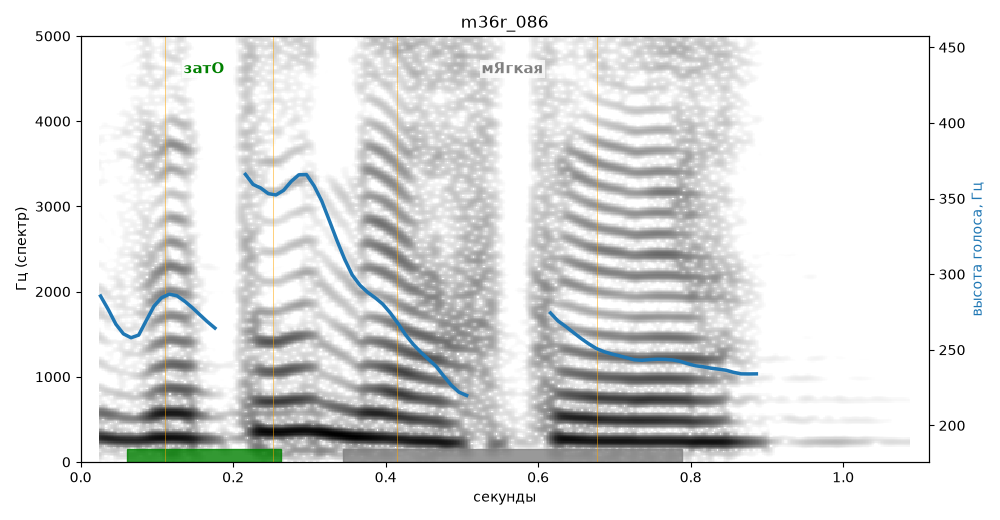

# m36r_086

Голос: **Рон (голос iPhone Milena), серия 36** · длительность 1.1 с
Эталон: Зато мягкая.
Распознано: Затумявки.
Расхождения в словах: «зато мягкая» → «затумявки»

## Ударения
(где нужно: ruaccent)

| слово | нужно | у голоса | |
|---|---|---|---|
| зато | затО | затО | ✓ |
| мягкая | мЯгкая | — | ? |

## Интонация
- ✗ «зато мягкая.» — конец фразы не понижается — звучит незаконченно / как перечисление
- Диапазон голоса 7.5 полутонов (живо), средняя высота 263 Гц

## Паузы и темп
- паузы на своих местах
- Темп 5.5 слога/с (нормально)

_Синяя линия — высота голоса. Над словами заглавная буква — где ударение должно быть; красным — голос поставил не туда (уверенно), оранжевым — возможно._
