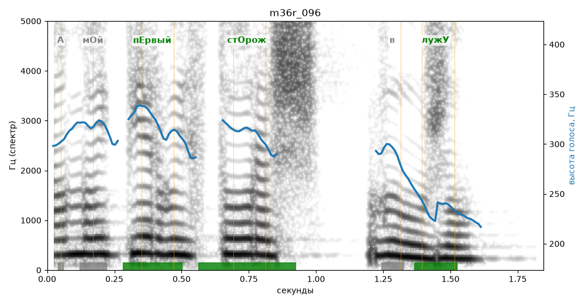

# m36r_096

Голос: **Рон (голос iPhone Milena), серия 36** · длительность 1.8 с
Эталон: А мой первый сторож — в лужу.
Распознано: А мой первый сторож влужу.
Расхождения в словах: «в лужу» → «влужу»

## Ударения
(где нужно: ruaccent)

| слово | нужно | у голоса | |
|---|---|---|---|
| первый | пЕрвый | пЕрвый | ✓ |
| сторож | стОрож | стОрож | ✓ |
| лужу | лужУ | лужУ | ✓ |

## Интонация
- ✓ «а мой первый сторож в лужу.» — конец фразы понижается — звучит законченно
- Диапазон голоса 6.7 полутонов (нормально), средняя высота 302 Гц

## Паузы и темп
- паузы на своих местах
- Темп 7.7 слога/с (быстро)

_Синяя линия — высота голоса. Над словами заглавная буква — где ударение должно быть; красным — голос поставил не туда (уверенно), оранжевым — возможно._
