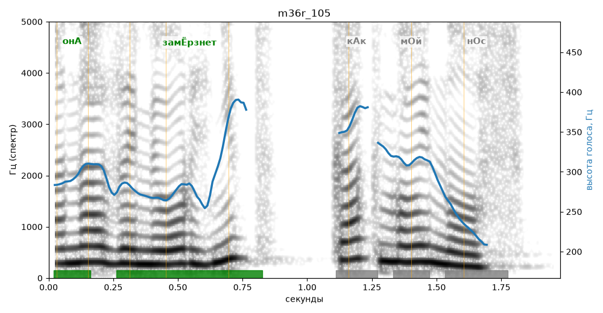

# m36r_105

Голос: **Рон (голос iPhone Milena), серия 36** · длительность 2.0 с
Эталон: Она замёрзнет? Как мой нос?
Распознано: Она замерзнет, как мой нос.
Слова: все совпали

## Ударения
(где нужно: ruaccent)

| слово | нужно | у голоса | |
|---|---|---|---|
| она | онА | онА | ✓ |
| замёрзнет | замЁрзнет | замЁрзнет | ✓ |

## Интонация
- ✗ «она замёрзнет?» — нет вопросительного подъёма (самое высокое место — «она», в начале) — звучит как утверждение
- ✓ «как мой нос?» — конец фразы понижается — звучит законченно
- Диапазон голоса 8.9 полутонов (живо), средняя высота 288 Гц

## Паузы и темп
- паузы на своих местах
- Темп 5.4 слога/с (нормально)

_Синяя линия — высота голоса. Над словами заглавная буква — где ударение должно быть; красным — голос поставил не туда (уверенно), оранжевым — возможно._
