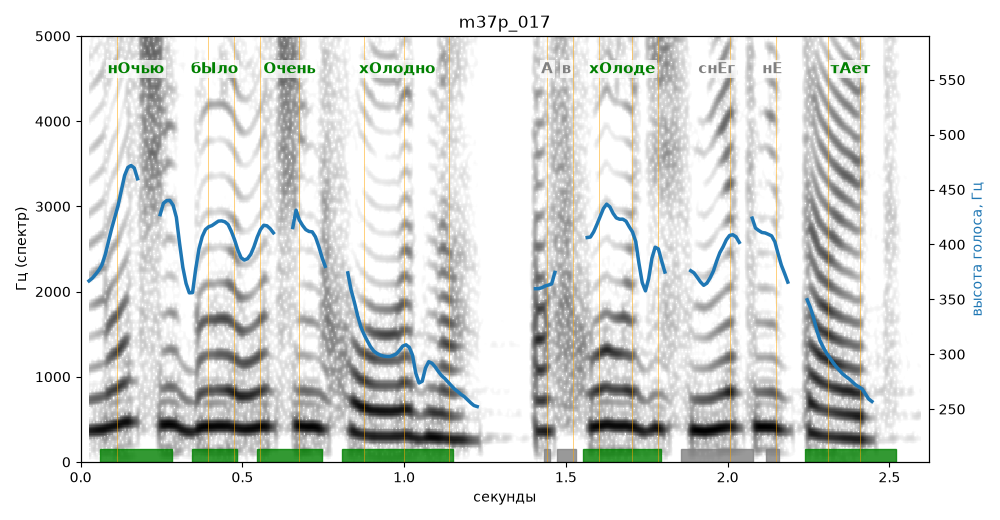

# m37p_017

Голос: **Пик (голос iPhone Milena), серия 37** · длительность 2.6 с
Эталон: Ночью было очень холодно. А в холоде снег не тает.
Распознано: Нучи было очень холодно, а входе не стоит.
Расхождения в словах: «ночью» → «нучи»; «в холоде снег» → «входе»; «тает» → «стоит»

## Ударения
(где нужно: ruaccent)

| слово | нужно | у голоса | |
|---|---|---|---|
| ночью | нОчью | нОчью | ✓ |
| было | бЫло | бЫло | ✓ |
| очень | Очень | Очень | ✓ |
| холодно | хОлодно | хОлодно | ✓ |
| холоде | хОлоде | хОлоде | ✓ |
| тает | тАет | тАет | ✓ |

## Интонация
- ✓ «ночью было очень холодно.» — конец фразы понижается — звучит законченно
- ✓ «а в холоде снег не тает.» — конец фразы понижается — звучит законченно
- Диапазон голоса 8.6 полутонов (живо), средняя высота 380 Гц

## Паузы и темп
- паузы на своих местах
- Темп 7.8 слога/с (быстро)

_Синяя линия — высота голоса. Над словами заглавная буква — где ударение должно быть; красным — голос поставил не туда (уверенно), оранжевым — возможно._
