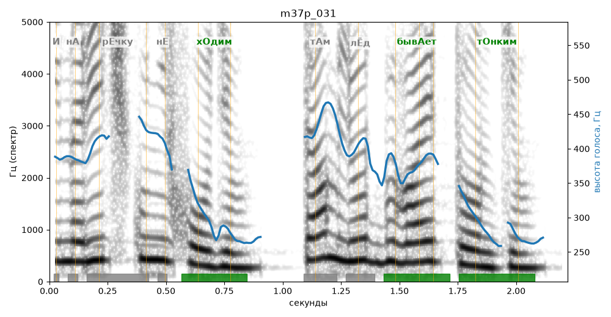

# m37p_031

Голос: **Пик (голос iPhone Milena), серия 37** · длительность 2.2 с
Эталон: И на речку не ходим. Там лёд бывает тонким.
Распознано: И на речку не ходим, там льуд бывает тонким.
Расхождения в словах: «лед» → «льуд»

## Ударения
(где нужно: ruaccent)

| слово | нужно | у голоса | |
|---|---|---|---|
| речку | рЕчку | речкУ | ? не разобрать |
| ходим | хОдим | хОдим | ✓ |
| бывает | бывАет | бывАет | ✓ |
| тонким | тОнким | тОнким | ✓ |

## Интонация
- ✓ «и на речку не ходим.» — конец фразы понижается — звучит законченно
- ✓ «там лёд бывает тонким.» — конец фразы понижается — звучит законченно
- Диапазон голоса 8.9 полутонов (живо), средняя высота 372 Гц

## Паузы и темп
- паузы на своих местах
- Темп 7.7 слога/с (быстро)

_Синяя линия — высота голоса. Над словами заглавная буква — где ударение должно быть; красным — голос поставил не туда (уверенно), оранжевым — возможно._
