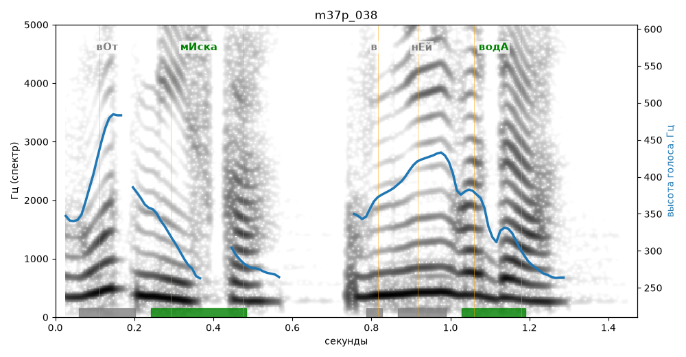

# m37p_038

Голос: **Пик (голос iPhone Milena), серия 37** · длительность 1.5 с
Эталон: Вот миска. В ней вода.
Распознано: Вот миска, в ней вода.
Слова: все совпали

## Ударения
(где нужно: ruaccent)

| слово | нужно | у голоса | |
|---|---|---|---|
| миска | мИска | мИска | ✓ |
| вода | водА | водА | ✓ |

## Интонация
- ✗ «вот миска.» — конец фразы не понижается — звучит незаконченно / как перечисление
- ✓ «в ней вода.» — конец фразы понижается — звучит законченно
- Диапазон голоса 9.1 полутонов (живо), средняя высота 347 Гц

## Паузы и темп
- паузы на своих местах
- Темп 8.5 слога/с (быстро)

_Синяя линия — высота голоса. Над словами заглавная буква — где ударение должно быть; красным — голос поставил не туда (уверенно), оранжевым — возможно._
