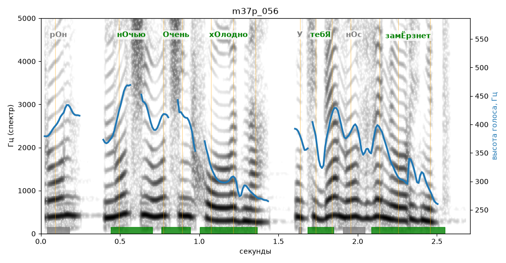

# m37p_056

Голос: **Пик (голос iPhone Milena), серия 37** · длительность 2.7 с
Эталон: Рон, ночью очень холодно. У тебя нос замёрзнет.
Распознано: Рон, ночи очень холодно, у тебя нозвеноргнет.
Расхождения в словах: «ночью» → «ночи»; «нос замерзнет» → «нозвеноргнет»

## Ударения
(где нужно: ruaccent)

| слово | нужно | у голоса | |
|---|---|---|---|
| ночью | нОчью | нОчью | ✓ |
| очень | Очень | Очень | ✓ |
| холодно | хОлодно | хОлодно | ✓ |
| тебя | тебЯ | тебЯ | ✓ |
| замёрзнет | замЁрзнет | замЁрзнет | ✓ |

## Интонация
- ✓ «рон ночью очень холодно.» — конец фразы понижается — звучит законченно
- ✓ «у тебя нос замёрзнет.» — конец фразы понижается — звучит законченно
- Диапазон голоса 8.2 полутонов (живо), средняя высота 373 Гц

## Паузы и темп
- паузы на своих местах
- Темп 7.0 слога/с (быстро)

_Синяя линия — высота голоса. Над словами заглавная буква — где ударение должно быть; красным — голос поставил не туда (уверенно), оранжевым — возможно._
