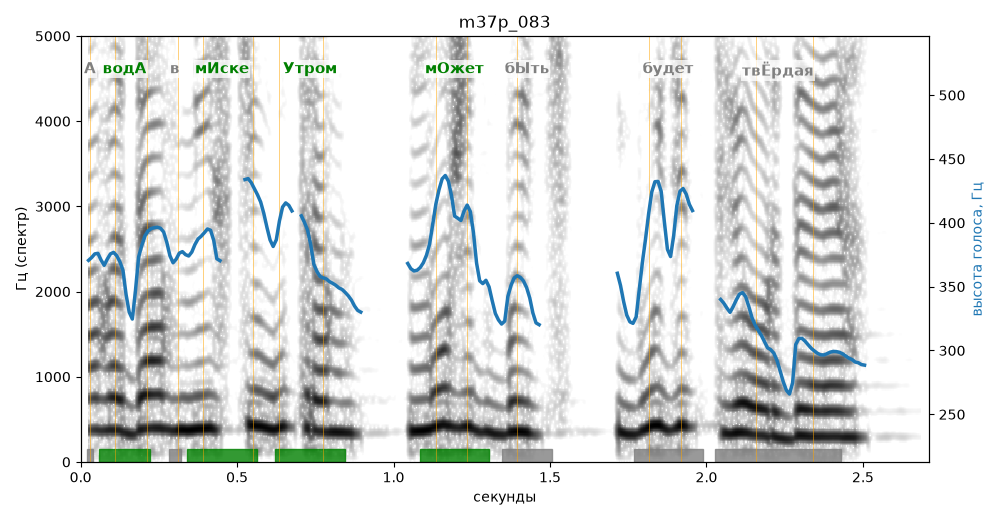

# m37p_083

Голос: **Пик (голос iPhone Milena), серия 37** · длительность 2.7 с
Эталон: А вода в миске утром, может быть, будет твёрдая.
Распознано: А вода в месте утром, может быть, будет твердые.
Расхождения в словах: «миске» → «месте»; «твердая» → «твердые»

## Ударения
(где нужно: ruaccent)

| слово | нужно | у голоса | |
|---|---|---|---|
| вода | водА | водА | ✓ |
| миске | мИске | мИске | ✓ |
| утром | Утром | Утром | ✓ |
| может | мОжет | мОжет | ✓ |
| будет | будет | бУдет | нет эталона |
| твёрдая | твЁрдая | — | ? |

## Интонация
- ✓ «а вода в миске утром может быть будет твёрдая.» — конец фразы понижается — звучит законченно
- Диапазон голоса 6.5 полутонов (нормально), средняя высота 363 Гц

## Паузы и темп
- паузы на своих местах
- Темп 7.9 слога/с (быстро)

_Синяя линия — высота голоса. Над словами заглавная буква — где ударение должно быть; красным — голос поставил не туда (уверенно), оранжевым — возможно._
