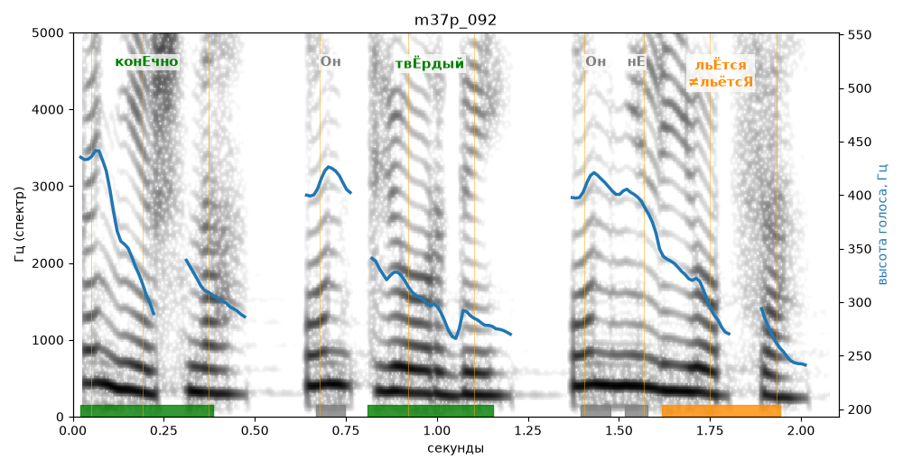

# m37p_092

Голос: **Пик (голос iPhone Milena), серия 37** · длительность 2.1 с
Эталон: Конечно. Он твёрдый. Он не льётся.
Распознано: Конечно, он пьердый, он не льется.
Расхождения в словах: «твердый» → «пьердый»

## Ударения
(где нужно: ruaccent)

| слово | нужно | у голоса | |
|---|---|---|---|
| конечно | конЕчно | конЕчно | ✓ |
| твёрдый | твЁрдый | твЁрдый | ✓ |
| льётся | льЁтся | льётсЯ | ✗? возможно — послушать |

## Интонация
- ✗ «конечно.» — конец фразы не понижается — звучит незаконченно / как перечисление
- ✗ «он твёрдый.» — конец фразы не понижается — звучит незаконченно / как перечисление
- ✓ «он не льётся.» — конец фразы понижается — звучит законченно
- Диапазон голоса 8.6 полутонов (живо), средняя высота 322 Гц

## Паузы и темп
- паузы на своих местах
- Темп 7.2 слога/с (быстро)

_Синяя линия — высота голоса. Над словами заглавная буква — где ударение должно быть; красным — голос поставил не туда (уверенно), оранжевым — возможно._
