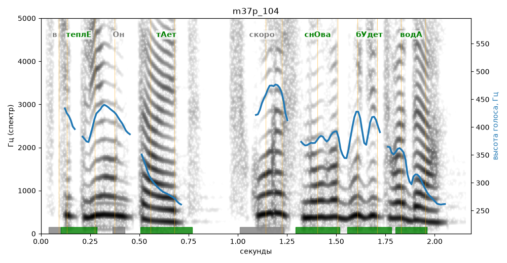

# m37p_104

Голос: **Пик (голос iPhone Milena), серия 37** · длительность 2.2 с
Эталон: В тепле он тает. Скоро снова будет вода.
Распознано: В тепре он тает, скоро с нога будет вода.
Расхождения в словах: «тепле» → «тепре»; «снова» → «с нога»

## Ударения
(где нужно: ruaccent)

| слово | нужно | у голоса | |
|---|---|---|---|
| тепле | теплЕ | теплЕ | ✓ |
| тает | тАет | тАет | ✓ |
| скоро | скоро | скОро | нет эталона |
| снова | снОва | снОва | ✓ |
| будет | бУдет | бУдет | ✓ |
| вода | водА | водА | ✓ |

## Интонация
- ✓ «в тепле он тает.» — конец фразы понижается — звучит законченно
- ✓ «скоро снова будет вода.» — конец фразы понижается — звучит законченно
- Диапазон голоса 9.6 полутонов (живо), средняя высота 377 Гц

## Паузы и темп
- паузы на своих местах
- Темп 8.3 слога/с (быстро)

_Синяя линия — высота голоса. Над словами заглавная буква — где ударение должно быть; красным — голос поставил не туда (уверенно), оранжевым — возможно._
