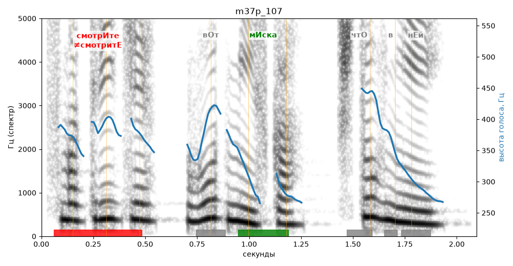

# m37p_107

Голос: **Пик (голос iPhone Milena), серия 37** · длительность 2.1 с
Эталон: Смотрите, вот миска. Что в ней?
Распознано: Смотрите, вод Миска, что в ней!
Расхождения в словах: «вот» → «вод»

## Ударения
(где нужно: ruaccent)

| слово | нужно | у голоса | |
|---|---|---|---|
| смотрите | смотрИте | смотритЕ | ✗ ОШИБКА |
| миска | мИска | мИска | ✓ |

## Интонация
- ✓ «смотрите вот миска.» — конец фразы понижается — звучит законченно
- ✓ «что в ней?» — конец фразы понижается — звучит законченно
- Диапазон голоса 8.4 полутонов (живо), средняя высота 359 Гц

## Паузы и темп
- паузы на своих местах
- Темп 7.1 слога/с (быстро)

_Синяя линия — высота голоса. Над словами заглавная буква — где ударение должно быть; красным — голос поставил не туда (уверенно), оранжевым — возможно._
