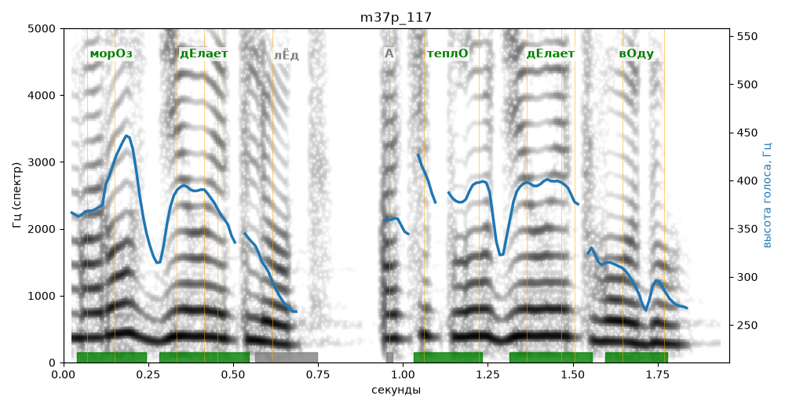

# m37p_117

Голос: **Пик (голос iPhone Milena), серия 37** · длительность 2.0 с
Эталон: Мороз делает лёд. А тепло делает воду.
Распознано: Мороз 9 лет, а теплые 9 лодут.
Расхождения в словах: «делает лед» → «9 лет»; «тепло делает воду» → «теплые 9 лодут»

## Ударения
(где нужно: ruaccent)

| слово | нужно | у голоса | |
|---|---|---|---|
| мороз | морОз | морОз | ✓ |
| делает | дЕлает | дЕлает | ✓ |
| тепло | теплО | теплО | ✓ |
| делает | дЕлает | дЕлает | ✓ |
| воду | вОду | вОду | ✓ |

## Интонация
- ✓ «мороз делает лёд.» — конец фразы понижается — звучит законченно
- ✓ «а тепло делает воду.» — конец фразы понижается — звучит законченно
- Диапазон голоса 7.4 полутонов (живо), средняя высота 364 Гц

## Паузы и темп
- паузы на своих местах
- Темп 9.1 слога/с (быстро)

_Синяя линия — высота голоса. Над словами заглавная буква — где ударение должно быть; красным — голос поставил не туда (уверенно), оранжевым — возможно._
