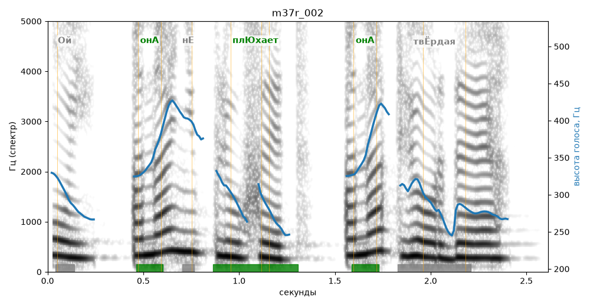

# m37r_002

Голос: **Рон (голос iPhone Milena), серия 37** · длительность 2.6 с
Эталон: Ой! Она не плюхает! Она твёрдая!
Распознано: Ой, она не плюхит, она тьордая.
Расхождения в словах: «плюхает» → «плюхит»; «твердая» → «тьордая»

## Ударения
(где нужно: ruaccent)

| слово | нужно | у голоса | |
|---|---|---|---|
| она | онА | онА | ✓ |
| плюхает | плЮхает | плЮхает | ✓ |
| она | онА | онА | ✓ |
| твёрдая | твЁрдая | — | ? |

## Интонация
- ✓ «она не плюхает!» — выделено слово «не» (+4.1 пт)
- ✓ «она твёрдая!» — выделено слово «она» (+4.4 пт)
- Диапазон голоса 8.5 полутонов (живо), средняя высота 305 Гц

## Паузы и темп
- паузы на своих местах
- Темп 7.0 слога/с (быстро)

_Синяя линия — высота голоса. Над словами заглавная буква — где ударение должно быть; красным — голос поставил не туда (уверенно), оранжевым — возможно._
