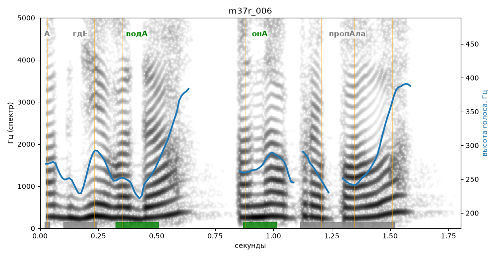

# m37r_006

Голос: **Рон (голос iPhone Milena), серия 37** · длительность 1.8 с
Эталон: А где вода? Она пропала?
Распознано: А где вода? Она пропала?
Слова: все совпали

## Ударения
(где нужно: ruaccent)

| слово | нужно | у голоса | |
|---|---|---|---|
| вода | водА | водА | ✓ |
| она | онА | онА | ✓ |
| пропала | пропАла | пропалА | ? не разобрать |

## Интонация
- ✗ «а где вода?» — нет вопросительного подъёма (самое высокое место — «вода», в начале) — звучит как утверждение
- ✗ «она пропала?» — нет вопросительного подъёма (самое высокое место — «она», в начале) — звучит как утверждение
- Диапазон голоса 8.7 полутонов (живо), средняя высота 266 Гц

## Паузы и темп
- паузы на своих местах
- Темп 7.9 слога/с (быстро)

_Синяя линия — высота голоса. Над словами заглавная буква — где ударение должно быть; красным — голос поставил не туда (уверенно), оранжевым — возможно._
