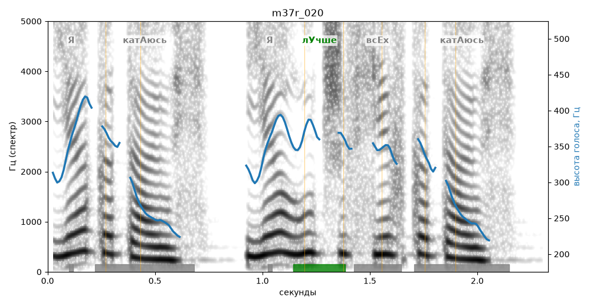

# m37r_020

Голос: **Рон (голос iPhone Milena), серия 37** · длительность 2.3 с
Эталон: Я катаюсь! Я лучше всех катаюсь!
Распознано: Я катаюсь, я лучше все вкатаюсь.
Расхождения в словах: «всех катаюсь» → «все вкатаюсь»

## Ударения
(где нужно: ruaccent)

| слово | нужно | у голоса | |
|---|---|---|---|
| катаюсь | катАюсь | — | ? |
| лучше | лУчше | лУчше | ✓ |
| катаюсь | катАюсь | — | ? |

## Интонация
- ✗ «я лучше всех катаюсь!» — восклицание звучит ровно, без эмоции
- Диапазон голоса 9.3 полутонов (живо), средняя высота 336 Гц

## Паузы и темп
- паузы на своих местах
- Темп 4.1 слога/с (нормально)

_Синяя линия — высота голоса. Над словами заглавная буква — где ударение должно быть; красным — голос поставил не туда (уверенно), оранжевым — возможно._
