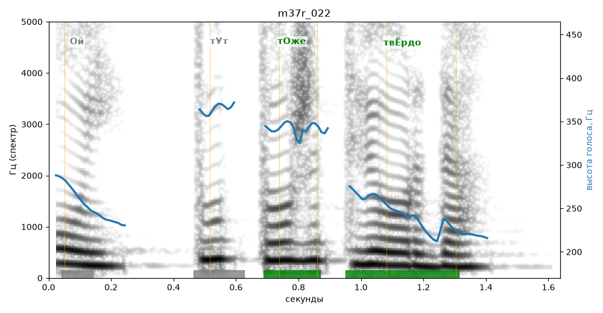

# m37r_022

Голос: **Рон (голос iPhone Milena), серия 37** · длительность 1.6 с
Эталон: Ой. Тут тоже твёрдо.
Распознано: Ой, тут тоже тлёрда.
Расхождения в словах: «твердо» → «тлерда»

## Ударения
(где нужно: ruaccent)

| слово | нужно | у голоса | |
|---|---|---|---|
| тоже | тОже | тОже | ✓ |
| твёрдо | твЁрдо | твЁрдо | ✓ |

## Интонация
- ✓ «тут тоже твёрдо.» — конец фразы понижается — звучит законченно
- Диапазон голоса 9.0 полутонов (живо), средняя высота 261 Гц

## Паузы и темп
- паузы на своих местах
- Темп 6.3 слога/с (нормально)

_Синяя линия — высота голоса. Над словами заглавная буква — где ударение должно быть; красным — голос поставил не туда (уверенно), оранжевым — возможно._
