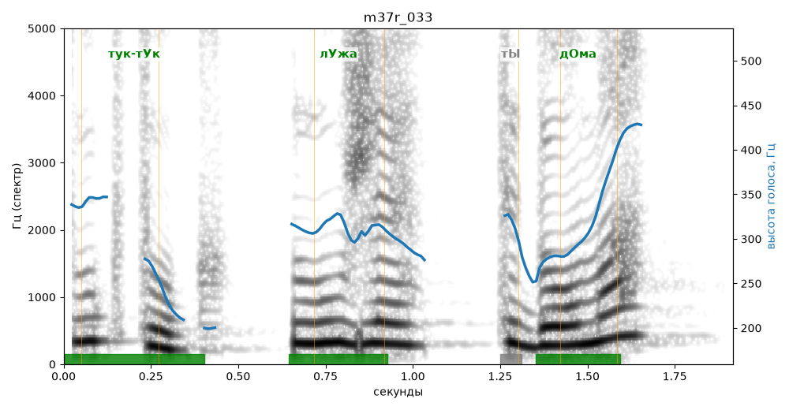

# m37r_033

Голос: **Рон (голос iPhone Milena), серия 37** · длительность 1.9 с
Эталон: Тук-тук! Лужа, ты дома?
Распознано: Ужа, ты дома?
Расхождения в словах: «тук-тук лужа» → «ужа»

## Ударения
(где нужно: ruaccent)

| слово | нужно | у голоса | |
|---|---|---|---|
| тук-тук | тук-тУк | тук-тУк | ✓ |
| лужа | лУжа | лУжа | ✓ |
| дома | дОма | дОма | ✓ |

## Интонация
- ✗ «лужа ты дома?» — нет вопросительного подъёма (самое высокое место — «лужа», в начале) — звучит как утверждение
- Диапазон голоса 11.7 полутонов (живо), средняя высота 307 Гц

## Паузы и темп
- паузы на своих местах
- Темп 6.8 слога/с (быстро)

_Синяя линия — высота голоса. Над словами заглавная буква — где ударение должно быть; красным — голос поставил не туда (уверенно), оранжевым — возможно._
