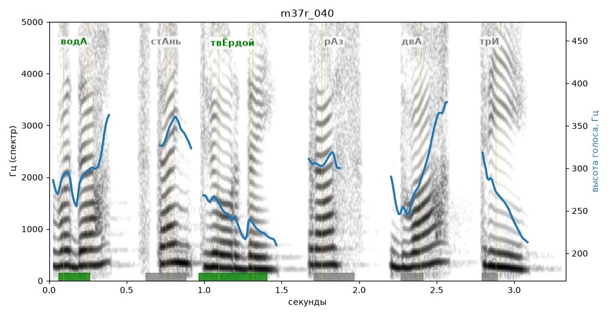

# m37r_040

Голос: **Рон (голос iPhone Milena), серия 37** · длительность 3.3 с
Эталон: Вода, стань твёрдой! Раз, два, три!
Распознано: Вода, стань тлёрдой, раз, два, три.
Расхождения в словах: «твердой» → «тлердой»

## Ударения
(где нужно: ruaccent)

| слово | нужно | у голоса | |
|---|---|---|---|
| вода | водА | водА | ✓ |
| твёрдой | твЁрдой | твЁрдой | ✓ |

## Интонация
- ✓ «вода стань твёрдой!» — выделено слово «стань» (+3.5 пт)
- ✗ «раз два три!» — восклицание звучит ровно, без эмоции
- Диапазон голоса 8.6 полутонов (живо), средняя высота 281 Гц

## Паузы и темп
- паузы на своих местах
- Темп 5.4 слога/с (нормально)

_Синяя линия — высота голоса. Над словами заглавная буква — где ударение должно быть; красным — голос поставил не туда (уверенно), оранжевым — возможно._
