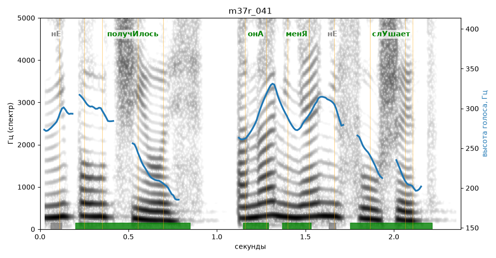

# m37r_041

Голос: **Рон (голос iPhone Milena), серия 37** · длительность 2.4 с
Эталон: Не получилось. Она меня не слушает.
Распознано: Не получилось, она меня не слушает.
Слова: все совпали

## Ударения
(где нужно: ruaccent)

| слово | нужно | у голоса | |
|---|---|---|---|
| получилось | получИлось | получИлось | ✓ |
| она | онА | онА | ✓ |
| меня | менЯ | менЯ | ✓ |
| слушает | слУшает | слУшает | ✓ |

## Интонация
- ✓ «не получилось.» — конец фразы понижается — звучит законченно
- ✓ «она меня не слушает.» — конец фразы понижается — звучит законченно
- Диапазон голоса 8.1 полутонов (живо), средняя высота 278 Гц

## Паузы и темп
- паузы на своих местах
- Темп 7.0 слога/с (быстро)

_Синяя линия — высота голоса. Над словами заглавная буква — где ударение должно быть; красным — голос поставил не туда (уверенно), оранжевым — возможно._
