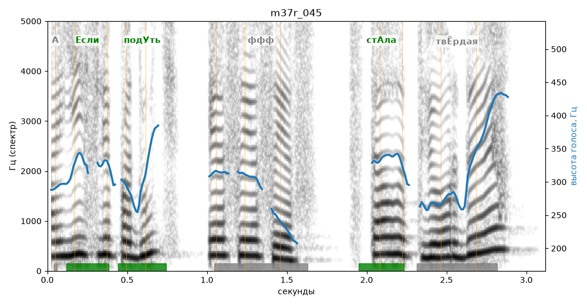

# m37r_045

Голос: **Рон (голос iPhone Milena), серия 37** · длительность 3.1 с
Эталон: А если подуть? Ффф! Стала твёрдая?
Распознано: А если подуть, ФФФ, стал отлёрдее?
Расхождения в словах: «стала твердая» → «стал отлердее»

## Ударения
(где нужно: ruaccent)

| слово | нужно | у голоса | |
|---|---|---|---|
| если | Если | Если | ✓ |
| подуть | подУть | подУть | ✓ |
| стала | стАла | стАла | ✓ |
| твёрдая | твЁрдая | — | ? |

## Интонация
- ✗ «а если подуть?» — нет вопросительного подъёма (самое высокое место — «если», в начале) — звучит как утверждение
- ✗ «стала твёрдая?» — нет вопросительного подъёма (самое высокое место — «стала», в начале) — звучит как утверждение
- Диапазон голоса 10.0 полутонов (живо), средняя высота 310 Гц

## Паузы и темп
- паузы на своих местах
- Темп 5.6 слога/с (нормально)

_Синяя линия — высота голоса. Над словами заглавная буква — где ударение должно быть; красным — голос поставил не туда (уверенно), оранжевым — возможно._
