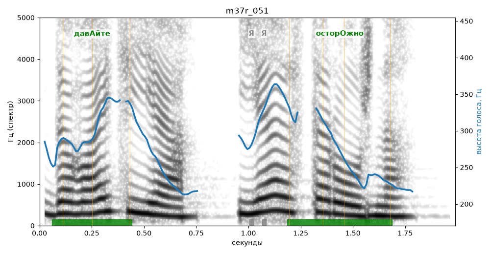

# m37r_051

Голос: **Рон (голос iPhone Milena), серия 37** · длительность 2.0 с
Эталон: Давайте я! Я осторожно!
Распознано: Давайте я, я осторожно.
Слова: все совпали

## Ударения
(где нужно: ruaccent)

| слово | нужно | у голоса | |
|---|---|---|---|
| давайте | давАйте | давАйте | ✓ |
| осторожно | осторОжно | осторОжно | ✓ |

## Интонация
- ✗ «давайте я!» — восклицание звучит ровно, без эмоции
- ✗ «я осторожно!» — восклицание звучит ровно, без эмоции
- Диапазон голоса 8.0 полутонов (живо), средняя высота 280 Гц

## Паузы и темп
- лишняя пауза 0.56 с между «давайте» и «я»
- после «я!» пауза всего 0.04 с — фразы слипаются
- Темп 6.6 слога/с (быстро)

_Синяя линия — высота голоса. Над словами заглавная буква — где ударение должно быть; красным — голос поставил не туда (уверенно), оранжевым — возможно._
