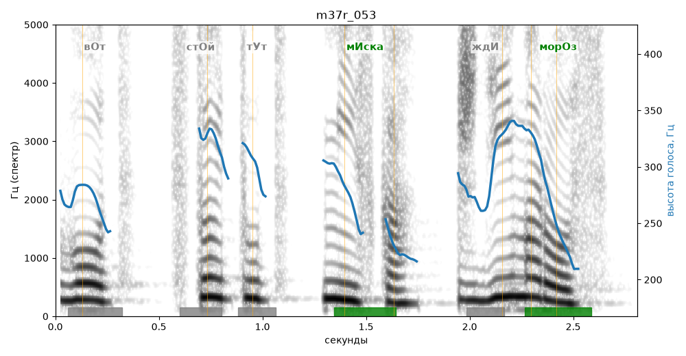

# m37r_053

Голос: **Рон (голос iPhone Milena), серия 37** · длительность 2.8 с
Эталон: Вот. Стой тут, миска. Жди мороз.
Распознано: Вот, стой тут, миска, жди мороз!
Слова: все совпали

## Ударения
(где нужно: ruaccent)

| слово | нужно | у голоса | |
|---|---|---|---|
| миска | мИска | мИска | ✓ |
| мороз | морОз | морОз | ✓ |

## Интонация
- ✓ «стой тут миска.» — конец фразы понижается — звучит законченно
- ✓ «жди мороз.» — конец фразы понижается — звучит законченно
- Диапазон голоса 7.4 полутонов (живо), средняя высота 282 Гц

## Паузы и темп
- паузы на своих местах
- Темп 4.9 слога/с (нормально)

_Синяя линия — высота голоса. Над словами заглавная буква — где ударение должно быть; красным — голос поставил не туда (уверенно), оранжевым — возможно._
