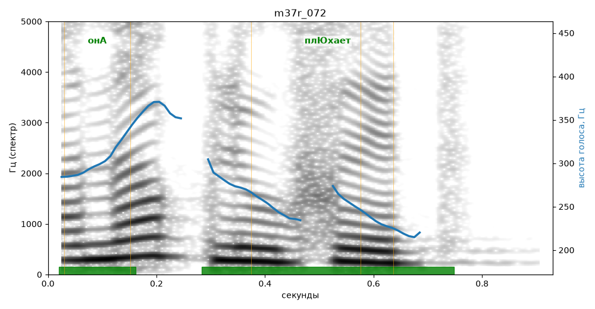

# m37r_072

Голос: **Рон (голос iPhone Milena), серия 37** · длительность 0.9 с
Эталон: Она плюхает!
Распознано: Now plume hit!
Расхождения в словах: «она плюхает» → «»

## Ударения
(где нужно: ruaccent)

| слово | нужно | у голоса | |
|---|---|---|---|
| она | онА | онА | ✓ |
| плюхает | плЮхает | плЮхает | ✓ |

## Интонация
- ✓ «она плюхает!» — выделено слово «она» (+5.0 пт)
- Диапазон голоса 8.8 полутонов (живо), средняя высота 274 Гц

## Паузы и темп
- паузы на своих местах
- Темп 6.9 слога/с (быстро)

_Синяя линия — высота голоса. Над словами заглавная буква — где ударение должно быть; красным — голос поставил не туда (уверенно), оранжевым — возможно._
