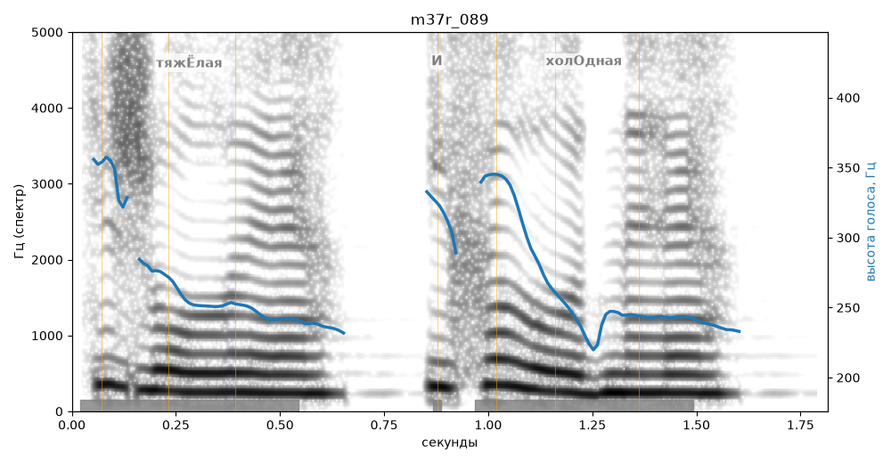

# m37r_089

Голос: **Рон (голос iPhone Milena), серия 37** · длительность 1.8 с
Эталон: Тяжёлая. И холодная!
Распознано: Скичulate!osing from the whole world! Душительauthер zona Delicious и cansators — использовало неприним Oscars — И не through the winners! Это 75% — и smile — и sharpen — It's 15% —Redis — за hinges — Бad supplying — Policense — Panic —
Расхождения в словах: «тяжелая» → «скич душитель ер»; «холодная» → «использовало неприним и не это 75 и и 15 за б»

## Ударения
(где нужно: ruaccent)

| слово | нужно | у голоса | |
|---|---|---|---|
| тяжёлая | тяжЁлая | — | ? |
| холодная | холОдная | — | ? |

## Интонация
- ✗ «тяжёлая.» — конец фразы не понижается — звучит незаконченно / как перечисление
- ✗ «и холодная!» — восклицание звучит ровно, без эмоции
- Диапазон голоса 6.8 полутонов (нормально), средняя высота 250 Гц

## Паузы и темп
- паузы на своих местах
- Темп 6.1 слога/с (нормально)

_Синяя линия — высота голоса. Над словами заглавная буква — где ударение должно быть; красным — голос поставил не туда (уверенно), оранжевым — возможно._
