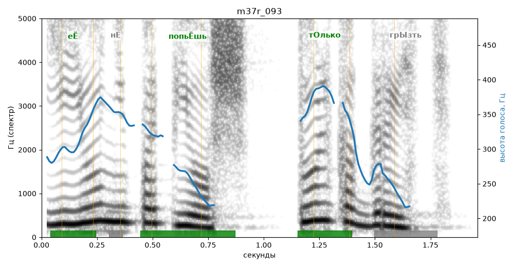

# m37r_093

Голос: **Рон (голос iPhone Milena), серия 37** · длительность 2.0 с
Эталон: Её не попьёшь! Только грызть!
Распознано: Её не попёшь, только грыть.
Расхождения в словах: «попьешь» → «попешь»; «грызть» → «грыть»

## Ударения
(где нужно: ruaccent)

| слово | нужно | у голоса | |
|---|---|---|---|
| её | еЁ | еЁ | ✓ |
| попьёшь | попьЁшь | попьЁшь | ✓ |
| только | тОлько | тОлько | ✓ |

## Интонация
- ✗ «её не попьёшь!» — восклицание звучит ровно, без эмоции
- ✓ «только грызть!» — выделено слово «только» (+3.9 пт)
- Диапазон голоса 9.5 полутонов (живо), средняя высота 304 Гц

## Паузы и темп
- паузы на своих местах
- Темп 5.5 слога/с (нормально)

_Синяя линия — высота голоса. Над словами заглавная буква — где ударение должно быть; красным — голос поставил не туда (уверенно), оранжевым — возможно._
