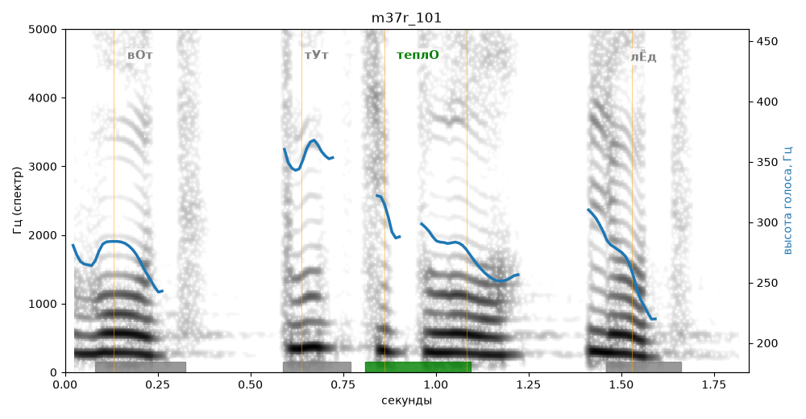

# m37r_101

Голос: **Рон (голос iPhone Milena), серия 37** · длительность 1.8 с
Эталон: Вот. Тут тепло, лёд.
Распознано: Вот, тут тепло, лед.
Слова: все совпали

## Ударения
(где нужно: ruaccent)

| слово | нужно | у голоса | |
|---|---|---|---|
| тепло | теплО | теплО | ✓ |

## Интонация
- ✓ «тут тепло лёд.» — конец фразы понижается — звучит законченно
- Диапазон голоса 7.0 полутонов (живо), средняя высота 281 Гц

## Паузы и темп
- паузы на своих местах
- Темп 5.3 слога/с (нормально)

_Синяя линия — высота голоса. Над словами заглавная буква — где ударение должно быть; красным — голос поставил не туда (уверенно), оранжевым — возможно._
