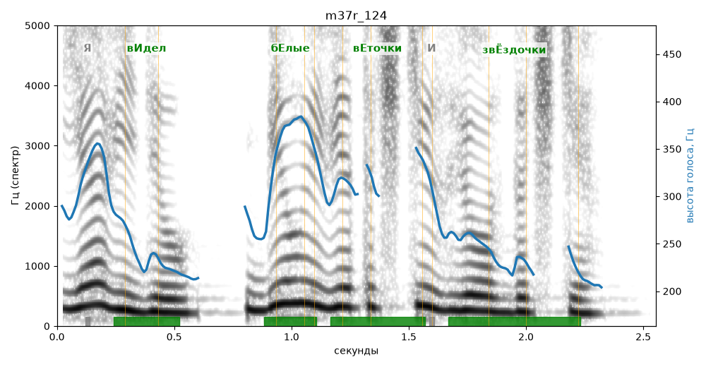

# m37r_124

Голос: **Рон (голос iPhone Milena), серия 37** · длительность 2.6 с
Эталон: Я видел. Белые веточки и звёздочки.
Распознано: Я видел белые веточки звездочки.
Расхождения в словах: «и» → «»

## Ударения
(где нужно: ruaccent)

| слово | нужно | у голоса | |
|---|---|---|---|
| видел | вИдел | вИдел | ✓ |
| белые | бЕлые | бЕлые | ✓ |
| веточки | вЕточки | вЕточки | ✓ |
| звёздочки | звЁздочки | звЁздочки | ✓ |

## Интонация
- ✓ «белые веточки и звёздочки.» — конец фразы понижается — звучит законченно
- Диапазон голоса 9.8 полутонов (живо), средняя высота 263 Гц

## Паузы и темп
- паузы на своих местах
- Темп 6.9 слога/с (быстро)

_Синяя линия — высота голоса. Над словами заглавная буква — где ударение должно быть; красным — голос поставил не туда (уверенно), оранжевым — возможно._
