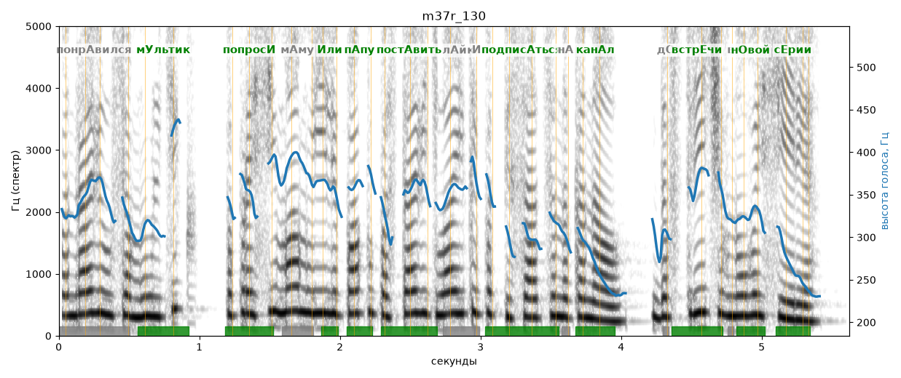

# m37r_130

Голос: **Рон (голос iPhone Milena), серия 37** · длительность 5.6 с
Эталон: Понравился мультик? Попроси маму или папу поставить лайк и подписаться на канал. До встречи в новой серии!
Распознано: понравился мультик, попроси мамы или папы поставить лайк и подписаться на канал. До встречи в новой серии!
Расхождения в словах: «маму» → «мамы»; «папу» → «папы»

## Ударения
(где нужно: ruaccent)

| слово | нужно | у голоса | |
|---|---|---|---|
| понравился | понрАвился | понравилсЯ | ? не разобрать |
| мультик | мУльтик | мУльтик | ✓ |
| попроси | попросИ | попросИ | ✓ |
| маму | мАму | мамУ | ? не разобрать |
| или | Или | Или | ✓ |
| папу | пАпу | пАпу | ✓ |
| поставить | постАвить | постАвить | ✓ |
| подписаться | подписАться | подписАться | ✓ |
| канал | канАл | канАл | ✓ |
| встречи | встрЕчи | встрЕчи | ✓ |
| новой | нОвой | нОвой | ✓ |
| серии | сЕрии | сЕрии | ✓ |

## Интонация
- ✗ «понравился мультик?» — нет вопросительного подъёма (самое высокое место — «понравился», в начале) — звучит как утверждение
- ✓ «попроси маму или папу поставить лайк и подписаться на канал.» — конец фразы понижается — звучит законченно
- ✓ «до встречи в новой серии!» — выделено слово «встречи» (+2.7 пт)
- Диапазон голоса 8.6 полутонов (живо), средняя высота 332 Гц

## Паузы и темп
- паузы на своих местах
- Темп 7.6 слога/с (быстро)

_Синяя линия — высота голоса. Над словами заглавная буква — где ударение должно быть; красным — голос поставил не туда (уверенно), оранжевым — возможно._
