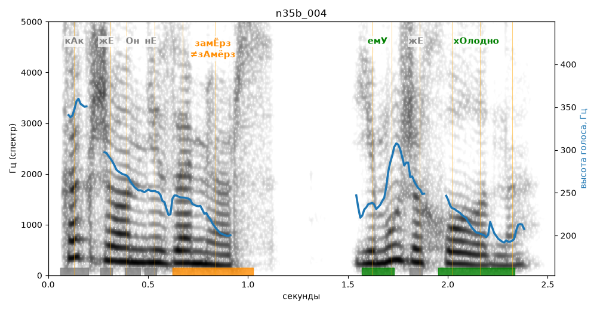

# n35b_004

Голос: **Барсик, сборка 35c** · длительность 2.5 с
Эталон: Как же он не замёрз? Ему же холодно!
Распознано: Как же он не замерз? Ему же холодно.
Слова: все совпали

## Ударения
(где нужно: ruaccent)

| слово | нужно | у голоса | |
|---|---|---|---|
| замёрз | замЁрз | зАмёрз | ✗? возможно — послушать |
| ему | емУ | емУ | ✓ |
| холодно | хОлодно | хОлодно | ✓ |

## Интонация
- ✓ «как же он не замёрз?» — конец фразы понижается — звучит законченно
- ✓ «ему же холодно!» — выделено слово «ему» (+3.8 пт)
- Диапазон голоса 9.6 полутонов (живо), средняя высота 240 Гц

## Паузы и темп
- паузы на своих местах
- Темп 6.9 слога/с (быстро)

_Синяя линия — высота голоса. Над словами заглавная буква — где ударение должно быть; красным — голос поставил не туда (уверенно), оранжевым — возможно._
