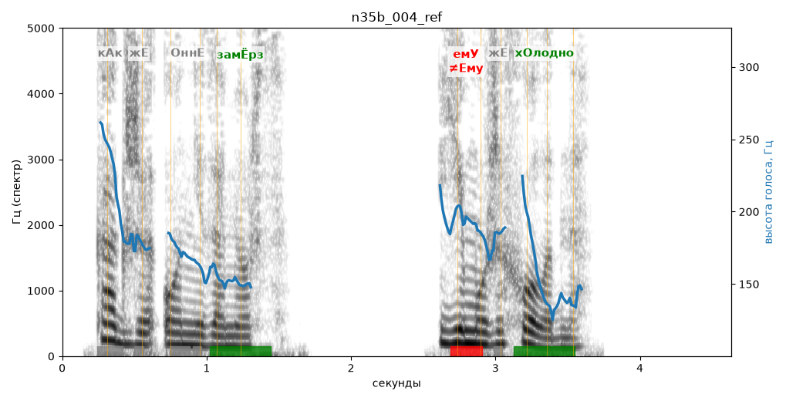

# n35b_004_ref

Голос: **edge:ru-RU-SvetlanaNeural** · длительность 4.6 с
Эталон: Как же он не замёрз? Ему же холодно!
Распознано: Как же он не замерз? Ему же холодно.
Слова: все совпали

## Ударения
(где нужно: ruaccent)

| слово | нужно | у голоса | |
|---|---|---|---|
| замёрз | замЁрз | замЁрз | ✓ |
| ему | емУ | Ему | ✗ ОШИБКА |
| холодно | хОлодно | хОлодно | ✓ |

## Интонация
- ✓ «как же он не замёрз?» — конец фразы понижается — звучит законченно
- ✗ «ему же холодно!» — восклицание звучит ровно, без эмоции
- Диапазон голоса 9.4 полутонов (живо), средняя высота 173 Гц

## Паузы и темп
- паузы на своих местах
- Темп 6.4 слога/с (нормально)

_Синяя линия — высота голоса. Над словами заглавная буква — где ударение должно быть; красным — голос поставил не туда (уверенно), оранжевым — возможно._
