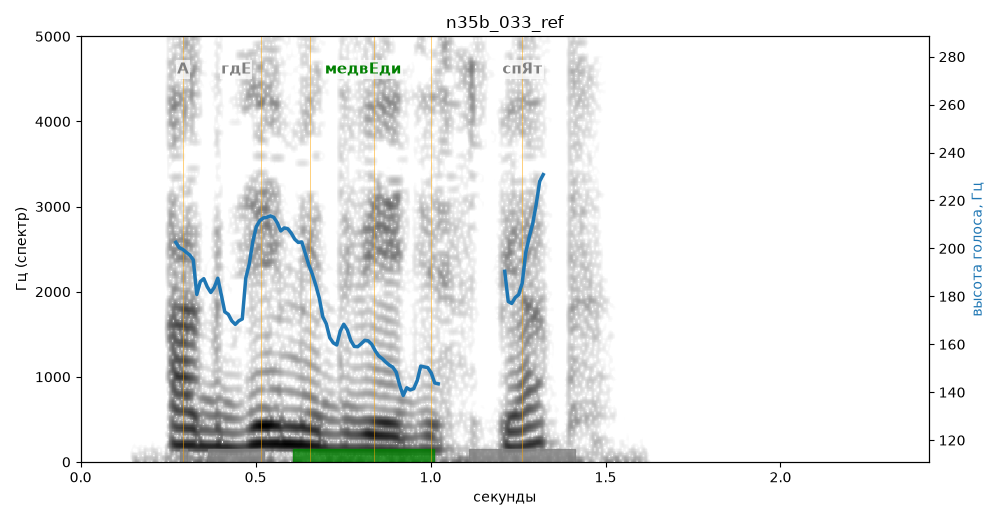

# n35b_033_ref

Голос: **edge:ru-RU-SvetlanaNeural** · длительность 2.4 с
Эталон: А где медведи спят?
Распознано: А где медведя спят?
Расхождения в словах: «медведи» → «медведя»

## Ударения
(где нужно: ruaccent)

| слово | нужно | у голоса | |
|---|---|---|---|
| медведи | медвЕди | медвЕди | ✓ |

## Интонация
- ✗ «а где медведи спят?» — нет вопросительного подъёма (самое высокое место — «где», в начале) — звучит как утверждение
- Диапазон голоса 6.9 полутонов (нормально), средняя высота 180 Гц

## Паузы и темп
- паузы на своих местах
- Темп 5.3 слога/с (нормально)

_Синяя линия — высота голоса. Над словами заглавная буква — где ударение должно быть; красным — голос поставил не туда (уверенно), оранжевым — возможно._
