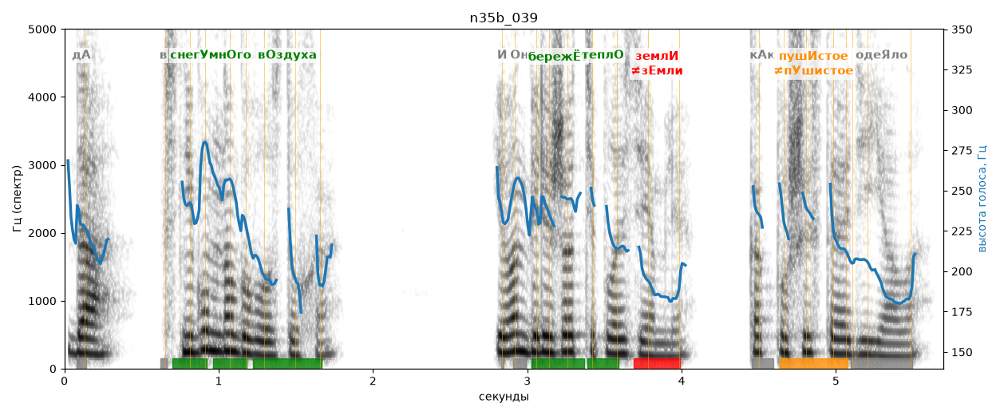

# n35b_039

Голос: **Барсик, сборка 35c** · длительность 5.7 с
Эталон: Да! В снегу много воздуха. И он бережёт тепло земли. Как пушистое одеяло.
Распознано: Да, в снегу много воздуха. И он бережет теплоземле, как пушистая одеяла.
Расхождения в словах: «тепло земли» → «теплоземле»; «пушистое одеяло» → «пушистая одеяла»

## Ударения
(где нужно: ruaccent)

| слово | нужно | у голоса | |
|---|---|---|---|
| снегу | снегУ | снегУ | ✓ |
| много | мнОго | мнОго | ✓ |
| воздуха | вОздуха | вОздуха | ✓ |
| бережёт | бережЁт | бережЁт | ✓ |
| тепло | теплО | теплО | ✓ |
| земли | землИ | зЕмли | ✗ ОШИБКА |
| пушистое | пушИстое | пУшистое | ✗? возможно — послушать |
| одеяло | одеЯло | — | ? |

## Интонация
- ✓ «в снегу много воздуха.» — конец фразы понижается — звучит законченно
- ✓ «и он бережёт тепло земли.» — конец фразы понижается — звучит законченно
- ✓ «как пушистое одеяло.» — конец фразы понижается — звучит законченно
- Диапазон голоса 5.9 полутонов (нормально), средняя высота 220 Гц

## Паузы и темп
- паузы на своих местах
- Темп 7.9 слога/с (быстро)

_Синяя линия — высота голоса. Над словами заглавная буква — где ударение должно быть; красным — голос поставил не туда (уверенно), оранжевым — возможно._
