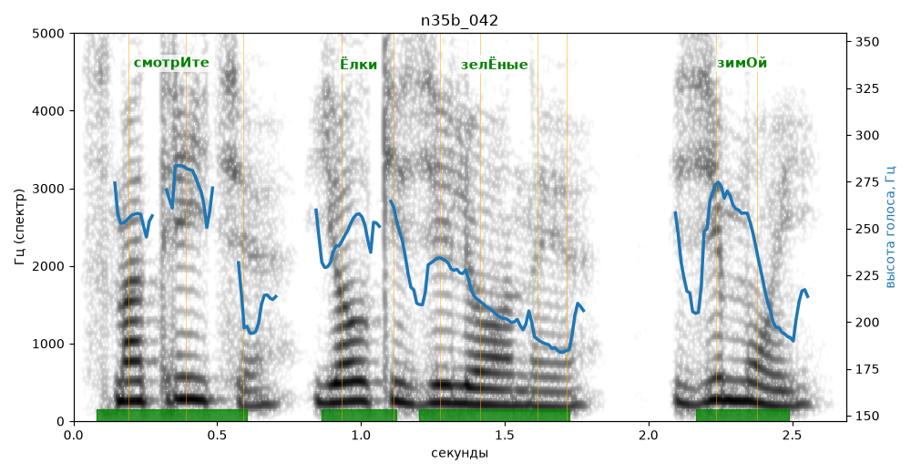

# n35b_042

Голос: **Барсик, сборка 35c** · длительность 2.7 с
Эталон: Смотрите, ёлки зелёные! Зимой!
Распознано: Смотрите, елки зелёные, зимой.
Слова: все совпали

## Ударения
(где нужно: ruaccent)

| слово | нужно | у голоса | |
|---|---|---|---|
| смотрите | смотрИте | смотрИте | ✓ |
| ёлки | Ёлки | Ёлки | ✓ |
| зелёные | зелЁные | зелЁные | ✓ |
| зимой | зимОй | зимОй | ✓ |

## Интонация
- ✓ «смотрите ёлки зелёные!» — выделено слово «смотрите» (+3.0 пт)
- Диапазон голоса 6.5 полутонов (нормально), средняя высота 229 Гц

## Паузы и темп
- паузы на своих местах
- Темп 6.5 слога/с (нормально)

_Синяя линия — высота голоса. Над словами заглавная буква — где ударение должно быть; красным — голос поставил не туда (уверенно), оранжевым — возможно._
