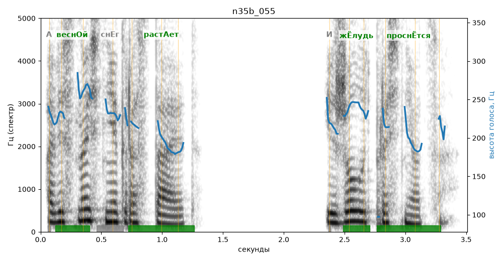

# n35b_055

Голос: **Барсик, сборка 35c** · длительность 3.5 с
Эталон: А весной снег растает. И жёлудь проснётся.
Распознано: А весной с ней красает, и желать проснётся.
Расхождения в словах: «снег растает» → «с ней красает»; «желудь» → «желать»

## Ударения
(где нужно: ruaccent)

| слово | нужно | у голоса | |
|---|---|---|---|
| весной | веснОй | веснОй | ✓ |
| растает | растАет | растАет | ✓ |
| жёлудь | жЁлудь | жЁлудь | ✓ |
| проснётся | проснЁтся | проснЁтся | ✓ |

## Интонация
- ✓ «а весной снег растает.» — конец фразы понижается — звучит законченно
- ✓ «и жёлудь проснётся.» — конец фразы понижается — звучит законченно
- Диапазон голоса 6.4 полутонов (нормально), средняя высота 222 Гц

## Паузы и темп
- паузы на своих местах
- Темп 6.1 слога/с (нормально)

_Синяя линия — высота голоса. Над словами заглавная буква — где ударение должно быть; красным — голос поставил не туда (уверенно), оранжевым — возможно._
