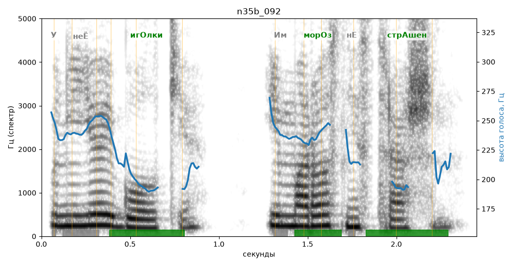

# n35b_092

Голос: **Барсик, сборка 35c** · длительность 2.5 с
Эталон: У неё иголки. Им мороз не страшен.
Распознано: У нее и голки, и мороз не страшен.
Расхождения в словах: «иголки им» → «и голки и»

## Ударения
(где нужно: ruaccent)

| слово | нужно | у голоса | |
|---|---|---|---|
| неё | неЁ | нЕё | ? не разобрать |
| иголки | игОлки | игОлки | ✓ |
| мороз | морОз | морОз | ✓ |
| страшен | стрАшен | стрАшен | ✓ |

## Интонация
- ✓ «у неё иголки.» — конец фразы понижается — звучит законченно
- ✓ «им мороз не страшен.» — конец фразы понижается — звучит законченно
- Диапазон голоса 4.8 полутонов (нормально), средняя высота 231 Гц

## Паузы и темп
- паузы на своих местах
- Темп 6.9 слога/с (быстро)

_Синяя линия — высота голоса. Над словами заглавная буква — где ударение должно быть; красным — голос поставил не туда (уверенно), оранжевым — возможно._
