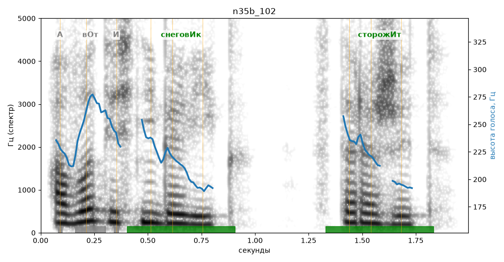

# n35b_102

Голос: **Барсик, сборка 35c** · длительность 2.0 с
Эталон: А вот и снеговик. Сторожит.
Распознано: А вот и снеговик, старожит.
Расхождения в словах: «сторожит» → «старожит»

## Ударения
(где нужно: ruaccent)

| слово | нужно | у голоса | |
|---|---|---|---|
| снеговик | снеговИк | снеговИк | ✓ |
| сторожит | сторожИт | сторожИт | ✓ |

## Интонация
- ✓ «а вот и снеговик.» — конец фразы понижается — звучит законченно
- ✓ «сторожит.» — конец фразы понижается — звучит законченно
- Диапазон голоса 5.8 полутонов (нормально), средняя высота 225 Гц

## Паузы и темп
- паузы на своих местах
- Темп 6.8 слога/с (быстро)

_Синяя линия — высота голоса. Над словами заглавная буква — где ударение должно быть; красным — голос поставил не туда (уверенно), оранжевым — возможно._
