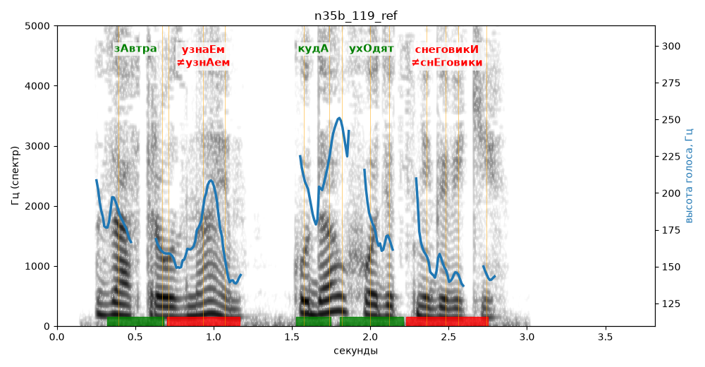

# n35b_119_ref

Голос: **edge:ru-RU-SvetlanaNeural** · длительность 3.8 с
Эталон: Завтра узнаем, куда уходят снеговики.
Распознано: Завтра узнаем, куда уходит с ниговики.
Расхождения в словах: «уходят снеговики» → «уходит с ниговики»

## Ударения
(где нужно: ruaccent)

| слово | нужно | у голоса | |
|---|---|---|---|
| завтра | зАвтра | зАвтра | ✓ |
| узнаем | узнаЕм | узнАем | ✗ ОШИБКА |
| куда | кудА | кудА | ✓ |
| уходят | ухОдят | ухОдят | ✓ |
| снеговики | снеговикИ | снЕговики | ✗ ОШИБКА |

## Интонация
- ✓ «завтра узнаем куда уходят снеговики.» — конец фразы понижается — звучит законченно
- Диапазон голоса 9.0 полутонов (живо), средняя высота 169 Гц

## Паузы и темп
- паузы на своих местах
- Темп 6.8 слога/с (быстро)

_Синяя линия — высота голоса. Над словами заглавная буква — где ударение должно быть; красным — голос поставил не туда (уверенно), оранжевым — возможно._
