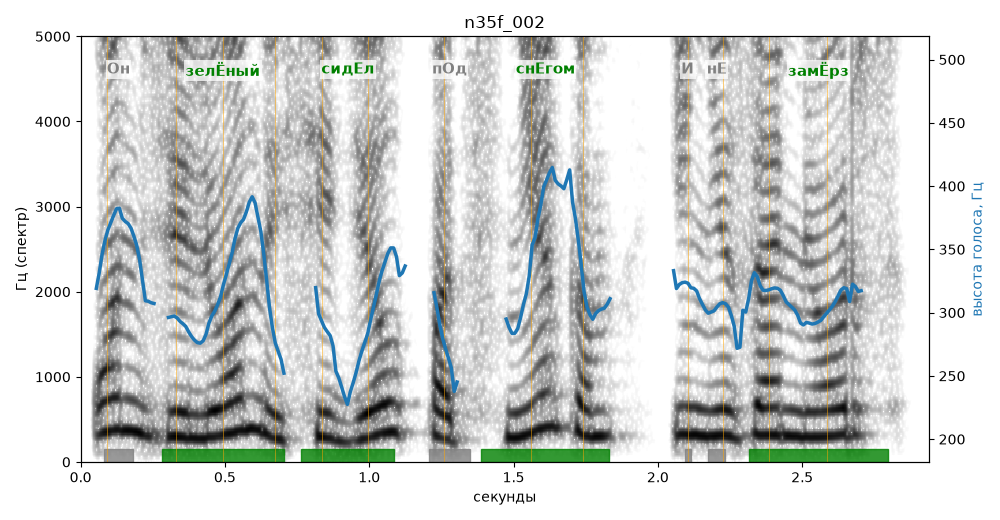

# n35f_002

Голос: **Филя, сборка 35c** · длительность 2.9 с
Эталон: Он зелёный! Сидел под снегом и не замёрз!
Распознано: Он зеленый сидел под снегом и не замерз.
Слова: все совпали

## Ударения
(где нужно: ruaccent)

| слово | нужно | у голоса | |
|---|---|---|---|
| зелёный | зелЁный | зелЁный | ✓ |
| сидел | сидЕл | сидЕл | ✓ |
| снегом | снЕгом | снЕгом | ✓ |
| замёрз | замЁрз | замЁрз | ✓ |

## Интонация
- ✓ «он зелёный!» — выделено слово «он» (+2.1 пт)
- ✗ «сидел под снегом и не замёрз!» — восклицание звучит ровно, без эмоции
- Диапазон голоса 7.4 полутонов (живо), средняя высота 309 Гц

## Паузы и темп
- после «зелёный!» пауза всего 0.06 с — фразы слипаются
- Темп 5.3 слога/с (нормально)

_Синяя линия — высота голоса. Над словами заглавная буква — где ударение должно быть; красным — голос поставил не туда (уверенно), оранжевым — возможно._
