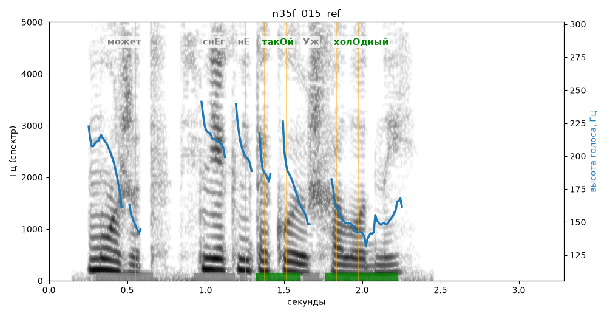

# n35f_015_ref

Голос: **edge:ru-RU-SvetlanaNeural** · длительность 3.3 с
Эталон: Может, снег не такой уж холодный?
Распознано: Может, снег не такой уж холодный?
Слова: все совпали

## Ударения
(где нужно: ruaccent)

| слово | нужно | у голоса | |
|---|---|---|---|
| может | может | мОжет | нет эталона |
| такой | такОй | такОй | ✓ |
| холодный | холОдный | холОдный | ✓ |

## Интонация
- ✓ «может снег не такой уж холодный?» — вопросительный подъём на слове «снег»
- Диапазон голоса 7.8 полутонов (живо), средняя высота 176 Гц

## Паузы и темп
- паузы на своих местах
- Темп 6.0 слога/с (нормально)

_Синяя линия — высота голоса. Над словами заглавная буква — где ударение должно быть; красным — голос поставил не туда (уверенно), оранжевым — возможно._
