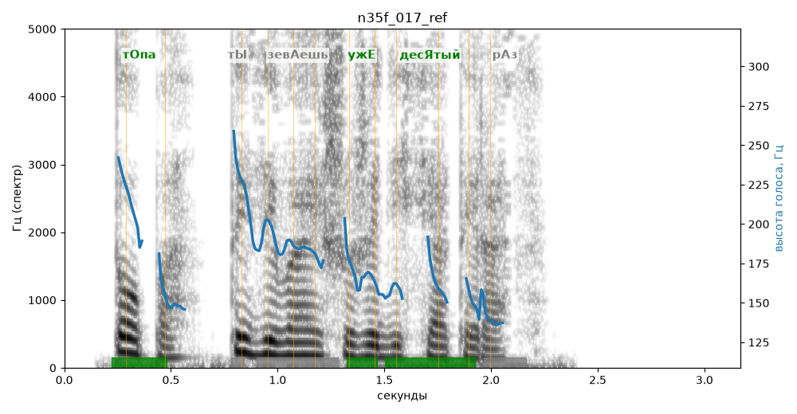

# n35f_017_ref

Голос: **edge:ru-RU-SvetlanaNeural** · длительность 3.2 с
Эталон: Топа, ты зеваешь уже десятый раз!
Распознано: Топа, ты зеваешь уже десятый раз.
Слова: все совпали

## Ударения
(где нужно: ruaccent)

| слово | нужно | у голоса | |
|---|---|---|---|
| топа | тОпа | тОпа | ✓ |
| зеваешь | зевАешь | зеваЕшь | ? не разобрать |
| уже | ужЕ | ужЕ | ✓ |
| десятый | десЯтый | десЯтый | ✓ |

## Интонация
- ✓ «топа ты зеваешь уже десятый раз!» — выделено слово «ты» (+5.0 пт)
- Диапазон голоса 8.6 полутонов (живо), средняя высота 171 Гц

## Паузы и темп
- паузы на своих местах
- Темп 7.3 слога/с (быстро)

_Синяя линия — высота голоса. Над словами заглавная буква — где ударение должно быть; красным — голос поставил не туда (уверенно), оранжевым — возможно._
