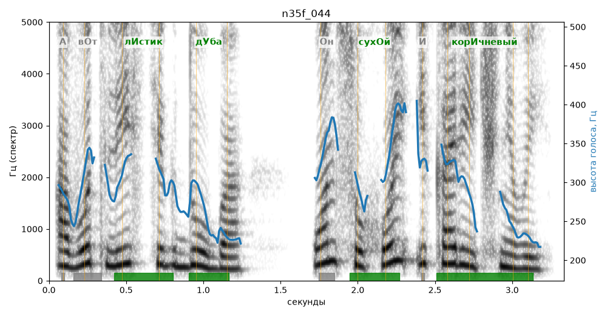

# n35f_044

Голос: **Филя, сборка 35c** · длительность 3.3 с
Эталон: А вот листик дуба. Он сухой и коричневый.
Распознано: А вот листик дуба. Он сухой и коричневый.
Слова: все совпали

## Ударения
(где нужно: ruaccent)

| слово | нужно | у голоса | |
|---|---|---|---|
| листик | лИстик | лИстик | ✓ |
| дуба | дУба | дУба | ✓ |
| сухой | сухОй | сухОй | ✓ |
| коричневый | корИчневый | корИчневый | ✓ |

## Интонация
- ✓ «а вот листик дуба.» — конец фразы понижается — звучит законченно
- ✓ «он сухой и коричневый.» — конец фразы понижается — звучит законченно
- Диапазон голоса 9.1 полутонов (живо), средняя высота 293 Гц

## Паузы и темп
- паузы на своих местах
- Темп 5.7 слога/с (нормально)

_Синяя линия — высота голоса. Над словами заглавная буква — где ударение должно быть; красным — голос поставил не туда (уверенно), оранжевым — возможно._
