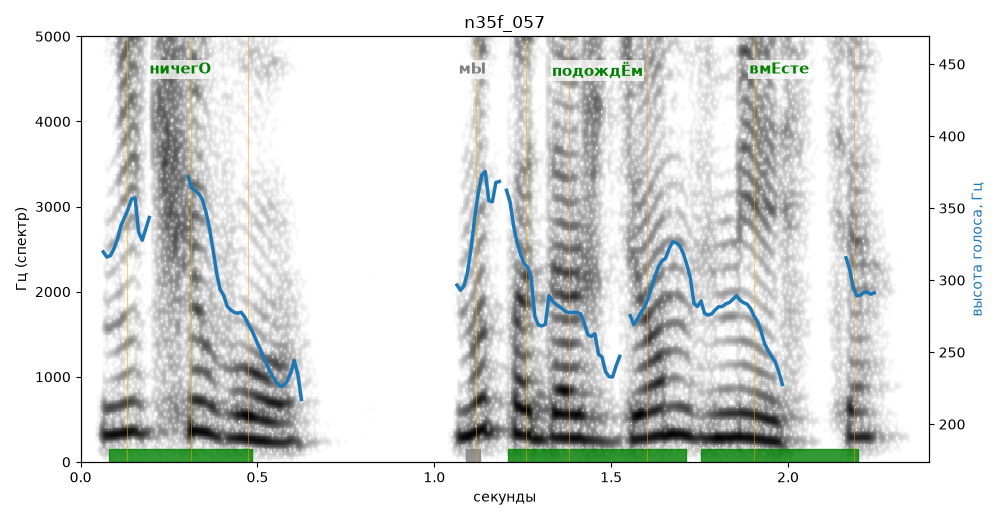

# n35f_057

Голос: **Филя, сборка 35c** · длительность 2.4 с
Эталон: Ничего. Мы подождём вместе.
Распознано: Ничего, мы подождем вместе.
Слова: все совпали

## Ударения
(где нужно: ruaccent)

| слово | нужно | у голоса | |
|---|---|---|---|
| ничего | ничегО | ничегО | ✓ |
| подождём | подождЁм | подождЁм | ✓ |
| вместе | вмЕсте | вмЕсте | ✓ |

## Интонация
- ✓ «ничего.» — конец фразы понижается — звучит законченно
- ✓ «мы подождём вместе.» — конец фразы понижается — звучит законченно
- Диапазон голоса 7.6 полутонов (живо), средняя высота 286 Гц

## Паузы и темп
- паузы на своих местах
- Темп 6.0 слога/с (нормально)

_Синяя линия — высота голоса. Над словами заглавная буква — где ударение должно быть; красным — голос поставил не туда (уверенно), оранжевым — возможно._
