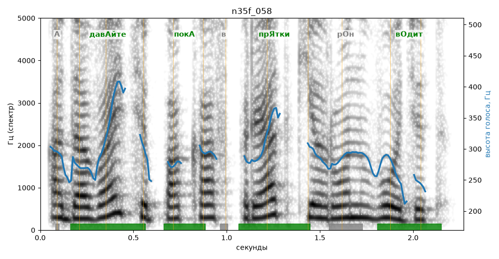

# n35f_058

Голос: **Филя, сборка 35c** · длительность 2.3 с
Эталон: А давайте пока в прятки! Рон водит!
Распознано: А давайте пока в прятке он водит.
Расхождения в словах: «прятки рон» → «прятке он»

## Ударения
(где нужно: ruaccent)

| слово | нужно | у голоса | |
|---|---|---|---|
| давайте | давАйте | давАйте | ✓ |
| пока | покА | покА | ✓ |
| прятки | прЯтки | прЯтки | ✓ |
| водит | вОдит | вОдит | ✓ |

## Интонация
- ✓ «а давайте пока в прятки!» — выделено слово «давайте» (+2.3 пт)
- ✗ «рон водит!» — восклицание звучит ровно, без эмоции
- Диапазон голоса 7.1 полутонов (живо), средняя высота 285 Гц

## Паузы и темп
- после «прятки!» пауза всего 0.10 с — фразы слипаются
- Темп 5.8 слога/с (нормально)

_Синяя линия — высота голоса. Над словами заглавная буква — где ударение должно быть; красным — голос поставил не туда (уверенно), оранжевым — возможно._
